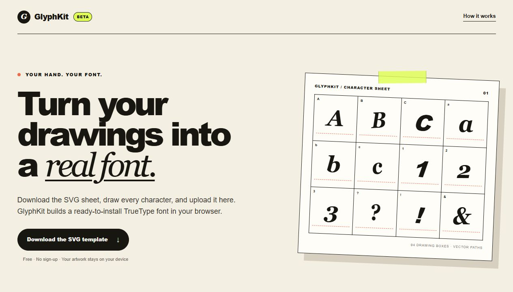

# GlyphKit

> Turn your drawings into an installable TrueType font in your browser.

## Make a font

1. Download the SVG character sheet from GlyphKit.
2. Open the sheet in a vector editor and draw your glyphs in their designated cells.
3. Upload the edited SVG to GlyphKit and download the resulting `.ttf` font.

GlyphKit processes the SVG in the browser. Your artwork stays on your device.

## Project files

This repository contains the static site export. Serve the repository root to preview it.
